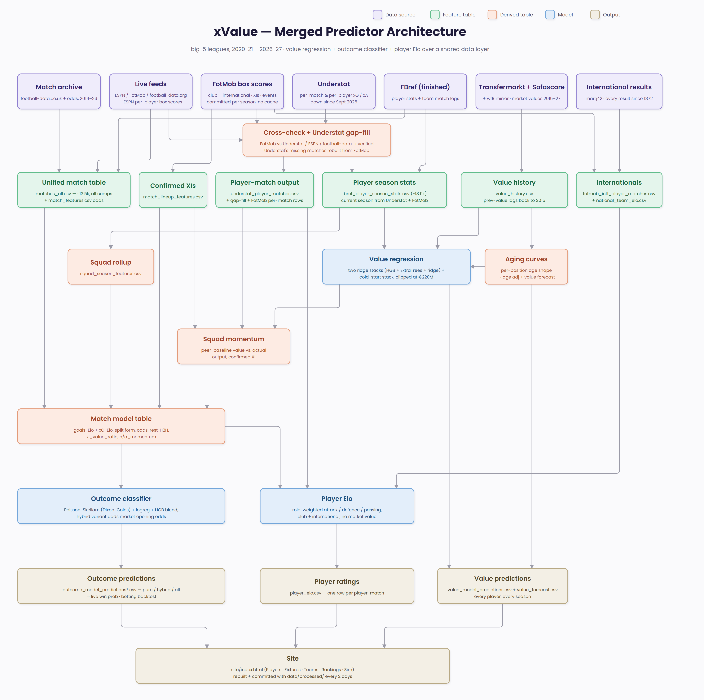

# xValue — a football predictor

Two models over a shared data layer for the **big-5 top flights — England,
Spain, Germany, Italy, France, 2020-21 → 2026-27** (+ the cups those clubs play in):

<!-- metrics:readme-headline -->
- **Value regression** — predicts a player's market value from his season + value
  history. Stacked trees (direct + change-from-last-value blend, capped at
  Transfermarkt's €220M ceiling), R²(log) **0.89**, MAE **€4.2M**, within-2×
  **91%** on a 2024-26 big-5 holdout — **0.90** with a prior-season value, **18%**
  median error in the €100M+ band. Outfield + keepers; scores every season
  including the current one.
- **Outcome classifier** — pre-match home-win / draw / away-win. Poisson-Skellam
  on Elo + form + xG, log-loss **0.977** (pure) / **0.974** (with market odds),
  vs Bet365 closing 0.971.
<!-- /metrics:readme-headline -->

(Headline numbers are generated from `data/processed/model_metrics.json` by
`src/update_doc_metrics.py` after every retrain.)

Alongside them, a **player Elo** (no market value anywhere in it) rates every
player match by match on a role-weighted blend of attacking output, defensive
actions and passing, against an opponent-adjusted expectation — in club matches
and international appearances alike.



`docs/models.md` has the full model detail; `run_pipeline.md` is the runbook.

## Data sources

| Source | What | Script |
| --- | --- | --- |
| football-data.co.uk | league results + bookmaker odds, 2014-26 (all big-5) | `pull_match_archive.py` |
| FBref (nodriver) | finished-season player stats (PL/BL/La Liga) + the deep columns nothing live carries, all-comps team match logs | `pull_fbref_*.py` |
| Understat (soccerdata) | per-match + per-player xG, 2020-now; the current-season goals/assists/minutes/xG and the Serie A / Ligue 1 player spine. **Down since late Sept 2026** - FotMob fills its missing matches (`understat_gapfill.py`) until it's back | `pull_understat*.py` |
| FotMob | per-match box scores: SoT / fouls / tackles / interceptions / blocks / clearances / touches / saves / passes completed + attempted; confirmed XIs + goal/red-card timelines; also xG / xA / minutes, which stand in for Understat while it's down | `pull_fotmob_players.py` |
| ESPN (player box scores) | per-player goals / assists / shots / SoT / fouls / saves, five leagues - the independent second source the FotMob rows are cross-checked against | `pull_espn_players.py` |
| Transfermarkt (mirror + nodriver) + Sofascore | market values, 2020-27. Sofascore IP-blocks GitHub's runners (and some residential IPs); without a `SOFASCORE_PROXY` secret the refresh keeps the last good `sofascore_values.csv` | `pull_transfermarkt*.py`, `pull_sofascore_values.py` |
| worldfootballR mirror | advanced player stats (xAG, progressive, tackles…), 2020-22 | `pull_wfr_advanced.py` |
| ESPN / FotMob / football-data.org | current-season fixtures/results + cup stats & xG | `pull_live.py`, `src/live/` |
| FotMob (internationals) | senior men's international box scores (World Cup, continental finals, qualifiers, Nations Leagues, friendlies), 2024-25 on | `pull_fotmob_internationals.py` |
| martj42/international_results | every men's international result since 1872 — national-team Elo | `pull_international_results.py` |

Unofficial JSON APIs are behind one pluggable schema (`src/live/`) so a source
going dark is swapped without touching anything downstream.

## Pipeline

| # | step | script | output |
| --- | --- | --- | --- |
| 1 | Match archive + live fixtures | `pull_match_archive.py`, `pull_live.py` | `match_features.csv`, `live_matches_<season>.csv` |
| 2 | Finished-season player stats | `pull_fbref_player_stats.py` → `parse_fbref_player_stats.py` | `fbref_player_season_stats.csv` (~18.9k rows, 291 cols) |
| 3 | Market values | `pull_transfermarkt*.py`, `pull_sofascore_values.py` → `build_value_history.py` | `value_history.csv`; folded into step 2 (~90% labelled) |
| 4 | Serie A / Ligue 1 player spine | `build_understat_player_seasons.py` (Understat + wfr mirror + FotMob + value history) | adds ~7.7k player-seasons to step 2 |
| 5 | Current-season stats | `pull_understat.py --current`, `pull_fotmob_players.py --current`, `pull_espn_players.py --current` → `verify_player_matches.py` → `understat_gapfill.py` → `build_current_season_stats.py` | per-match rows cross-checked (`verified` column), Understat's gaps filled from FotMob, then the 2026-27 rows of step 2 rewritten — no browser |
| 6 | Cross-source name resolution | alias map + transliteration in `src/live/schema.py`, fuzzy value fill in the parser, `player_name_map.csv` (~95%) | — |
| 7 | Unified match table | `build_matches_all.py` | `matches_all.csv` (~13.5k matches, all comps) |
| 8 | Squad rollup | `build_squad_features.py` | `squad_season_features.csv` |
| 9 | Value model | `train_value_model.py` | `models/value_model.pkl`, `value_model_predictions.csv` |
| 10 | Form / momentum | `build_form_momentum.py` (peer-baseline value vs. actual output) → re-run `build_match_model_table.py` | `squad_momentum.csv` |
| 11 | Outcome model | `build_match_model_table.py` → `train_outcome_model.py [--hybrid]` | `outcome_model_predictions*.csv` |
| 12 | Player Elo | `build_national_elo.py` → `build_player_elo.py` (opponent-adjusted, no market value; role-weighted attack / defence / passing from Understat + FotMob, club + international) | `national_team_elo.csv`, `player_elo.csv` |
| 13 | Site | `export_site_data.py` | `site/index.html` |
| — | Checks | `check_model_metrics.py` (regression gate), `pytest tests`, `update_doc_metrics.py` | `model_metrics.json`, the numbers in this README |
| 14 | SQLite mirror (local only) | `build_sqlite_db.py` (one table per CSV, fully replaced each run; gitignored and not built in CI - ~150 MB is over GitHub's 100 MB file limit) | `data/processed/xvalue.db` |

## Setup

```
py -3.11 -m pip install -r requirements.txt   # Python 3.11 required
```

Then follow `run_pipeline.md`.

## Notes

- **Python 3.11** — `nodriver` and soccerdata's TLS client don't work on 3.14 here.
- The ongoing season is **browser-free**: goals/assists/minutes/xG from Understat,
  SoT/fouls/tackles from FotMob, folded in by `build_current_season_stats.py`.
  The FBref browser scrape (visible Chrome) is now only for finished seasons and
  the deep columns nothing else carries — run it roughly monthly. The
  Transfermarkt scrape (visible Chrome + a one-off WAF-captcha click) is also
  monthly-manual.
- `data/processed/` is committed (built tables + pulled sources) and is the
  only record of what has been pulled: every pull skips matches already in it,
  so CI keeps no fetch cache. Per-match source rows live in
  `data/processed/fotmob/`, `espn/` and `live/`, split per season. `data/raw/`
  and the soccerdata cache are gitignored scratch.
- **Forward-test ledger**: every refresh freezes the site's pre-match odds for
  upcoming fixtures in an append-only `predictions_ledger.csv` (timestamp +
  model-version hash); the site's Track Record tab scores them against results
  and the closing market as the season goes, next to a calibration diagram.
- **Tests + regression gate**: the refresh runs `tests/` (data invariants +
  unit tests) and `check_model_metrics.py` (fails if value R²(log) or 1X2
  log-loss got worse past tolerance vs the committed `model_metrics.json`)
  before it commits - see `run_pipeline.md` §5.
- Every FotMob player-match row carries `verified` = agree / conflict /
  fotmob_only and `conflicts` (e.g. `espn:fouls`), from
  `verify_player_matches.py`'s cross-check against Understat, ESPN and
  football-data.co.uk (internationals: martj42). Rows are flagged, never
  dropped or overwritten.
